<h1 align="center">VectorCraft</h1>

<p align="center">
  <b>Vector illustration; an open-source, clean-room reimplementation of Adobe Illustrator, rebuilt in pure Rust.</b>
</p>

<p align="center">
  A fast, open-source, clean-room take on the Adobe Illustrator workflow. It runs natively on
  macOS, Windows, Linux and FreeBSD, and in the browser via WebAssembly.
</p>

<p align="center">
  
  
  
  
  
</p>

<br>

<p align="center">
  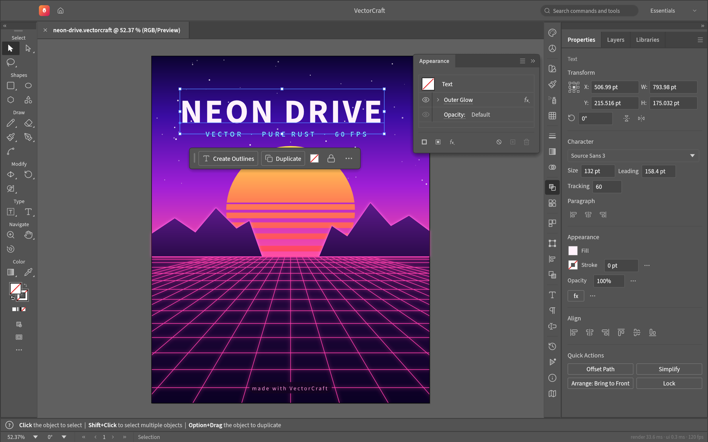
  <br><sub><b>Neon Drive</b>: a Pathfinder-cut sun, live Outer Glow on the type and grid, and clipping masks · <code>examples/neon-drive.vectorcraft</code></sub>
</p>

<p align="center">
  <a href="#a-look-around">A look around</a> ·
  <a href="#made-in-vectorcraft">Made in VectorCraft</a> ·
  <a href="#why-vectorcraft">Why VectorCraft</a> ·
  <a href="#quick-start">Quick start</a> ·
  <a href="#built-for-agents">Built for agents</a> ·
  <a href="#status">Status</a> ·
  <a href="#downloads">Downloads</a> ·
  <a href="#contributing">Contributing</a> ·
  <a href="#license-and-credits">License</a>
</p>

## A look around

<table>
<tr>
<td width="50%" valign="top">
  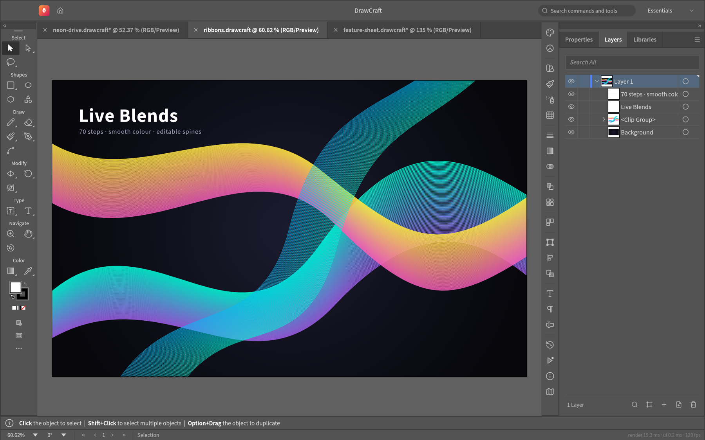
  <p align="center"><sub><b>Live Blends and Layers</b>: editable key paths, smooth colour, every object a row</sub></p>
</td>
<td width="50%" valign="top">
  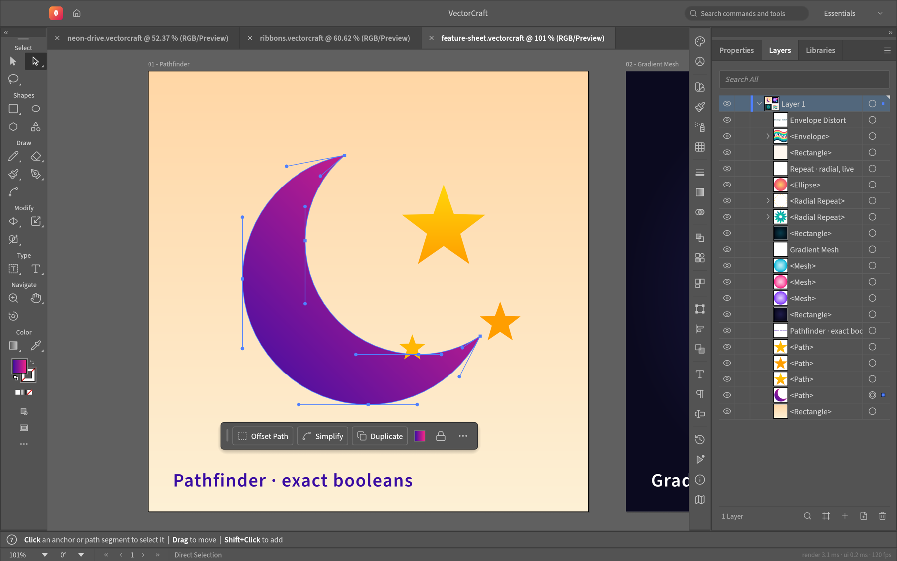
  <p align="center"><sub><b>Pen and Direct Selection</b>: real Bézier anchors and handles, plus a contextual task bar</sub></p>
</td>
</tr>
<tr>
<td width="50%" valign="top">
  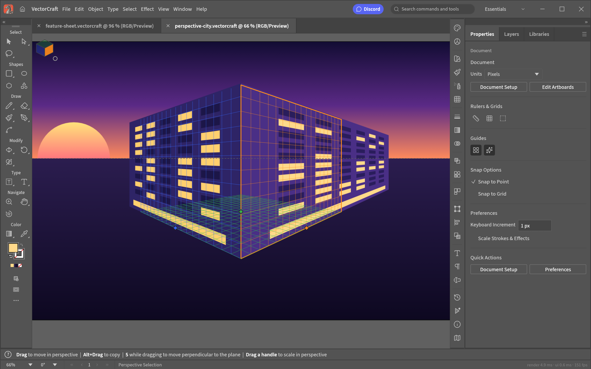
  <p align="center"><sub><b>Perspective Grid</b>: art attached to its planes stays editable in perspective · <code>examples/perspective-city.vectorcraft</code></sub></p>
</td>
<td width="50%" valign="top">
  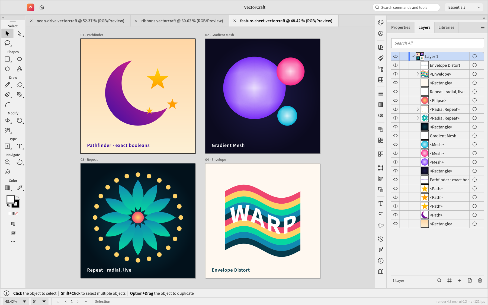
  <p align="center"><sub><b>Multiple artboards, light theme</b>: Pathfinder · Gradient Mesh · live radial Repeat · Envelope Distort · <code>examples/feature-sheet.vectorcraft</code></sub></p>
</td>
</tr>
</table>

## Made in VectorCraft

Every piece below was built entirely through VectorCraft's command API, the same one the MCP server
exposes to agents, and exported by VectorCraft's own renderer. The source files are in
[`examples/`](examples).

<table>
<tr>
<td width="50%" valign="top">
  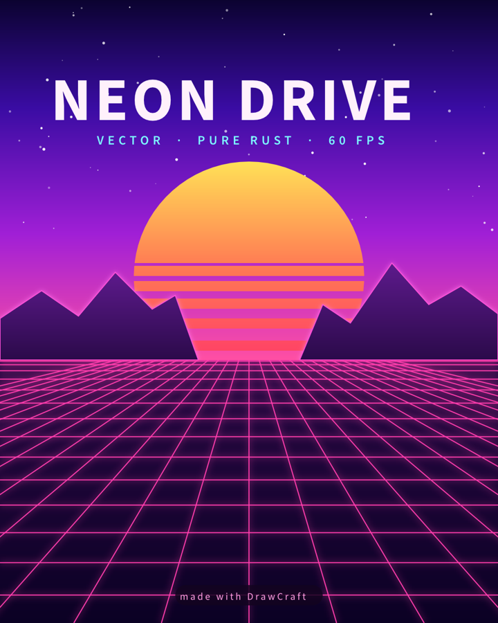
  <p align="center"><sub><b>Neon Drive</b>: synthwave poster with glowing type and grid</sub></p>
</td>
<td width="50%" valign="top">
  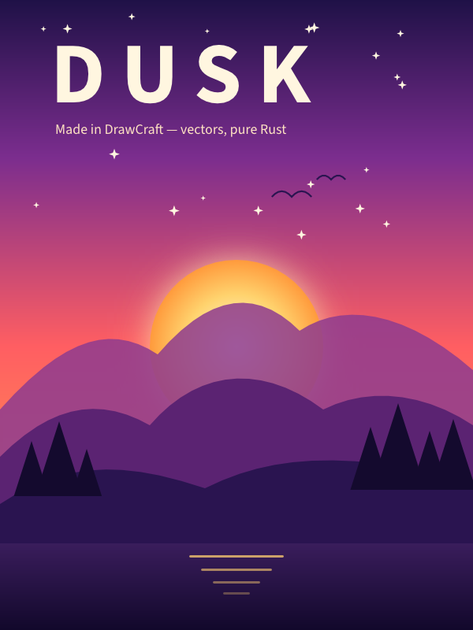
  <p align="center"><sub><b>Dusk</b>: gradient sky, glowing sun, layered mountains</sub></p>
</td>
</tr>
<tr>
<td colspan="2" valign="top">
  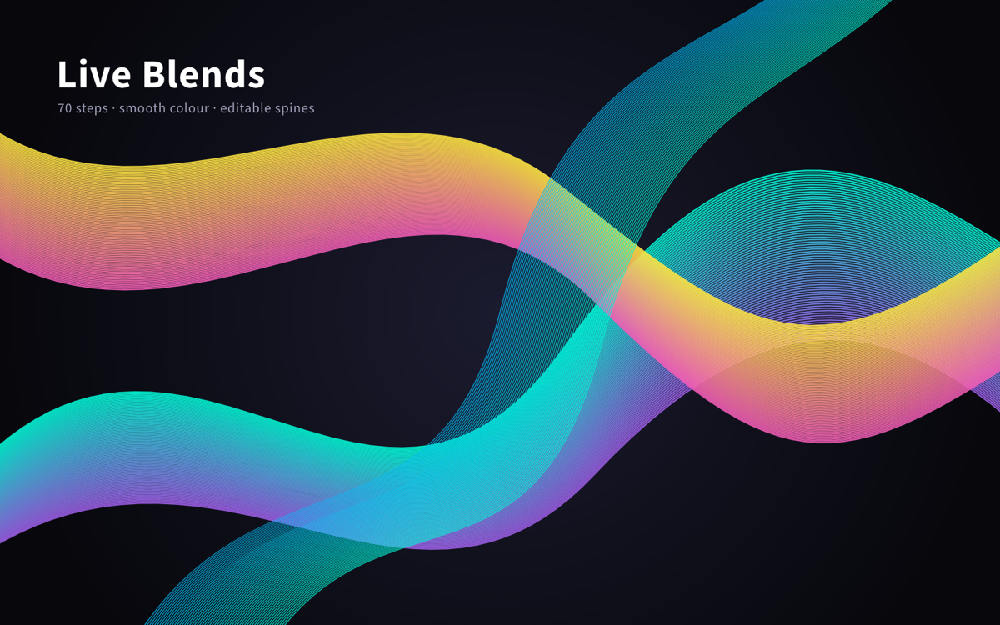
  <p align="center"><sub><b>Live Blends</b>: 70 steps, smooth colour, editable spines</sub></p>
</td>
</tr>
<tr>
<td width="50%" valign="top">
  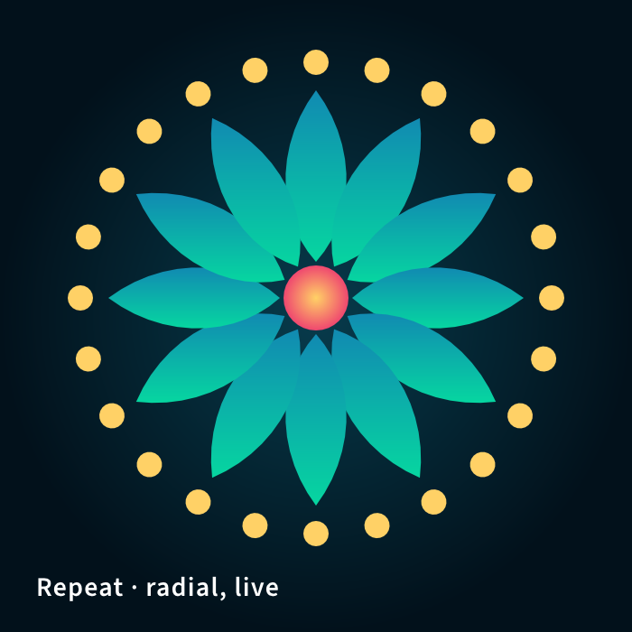
  <p align="center"><sub><b>Radial Repeat</b>: a live mandala</sub></p>
</td>
<td width="50%" valign="top">
  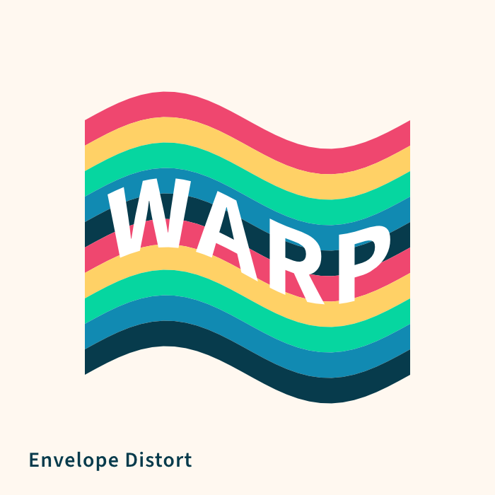
  <p align="center"><sub><b>Envelope Distort</b>: striped type warped into a flag</sub></p>
</td>
</tr>
<tr>
<td width="50%" valign="top">
  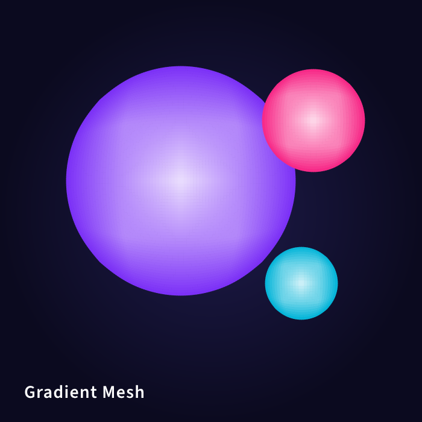
  <p align="center"><sub><b>Gradient Mesh</b>: shaded spheres</sub></p>
</td>
<td width="50%" valign="top">
  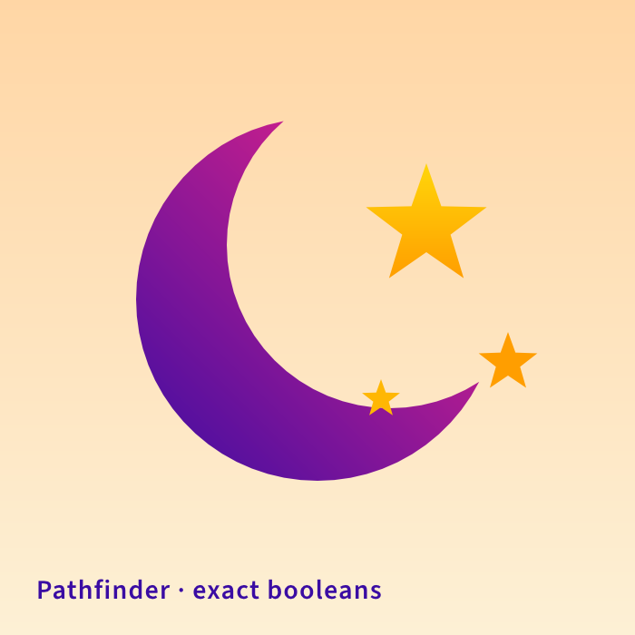
  <p align="center"><sub><b>Pathfinder</b>: a crescent and stars from exact booleans</sub></p>
</td>
</tr>
</table>

## Why VectorCraft

- **Familiar.** Illustrator's layout, tools, menus, panels and shortcuts: the Pen, Direct Selection,
  Pathfinder, Smart Guides, Appearance, Swatches, Layers and more. You already know how to use it.
- **Fast.** Multithreaded SIMD rendering off the UI thread. 20,000 shapes render in about 27 ms at
  full retina resolution while the interface stays at 120 fps.
- **Robust.** Exact curve booleans (no "cannot perform operation"), unlimited undo via structural
  sharing, and property-tested file round trips.
- **Open.** A documented native format (`.vectorcraft`, JSON), first-class SVG, PDF (and
  PDF-compatible `.ai`) import and export, PNG/JPEG/WebP export, Export for Screens, and SVGZ,
  templates, GIF, TIFF and BMP on open.
- **Agent-native.** Every menu item, tool gesture, panel and dialog can be driven over a JSON
  control channel and an **MCP server**, so AI agents can draw, edit and export the way a person
  does.
- **Everywhere.** One codebase for the desktop apps and the same UI in the browser.

## Quick start

Ubuntu users: see the [Ubuntu 24.04 / 26.04 LTS guide](docs/ubuntu.md) for dependencies,
building, installation and desktop troubleshooting.

```sh
cargo run --release -p vectorcraft                          # desktop app
cargo run --release -p vectorcraft -- examples/dusk-poster.vectorcraft
cargo run --release -p vectorcraft -- --control 7979        # + JSON control channel
cargo run --release -p vectorcraft-cli -- mcp               # MCP server (stdio)
cargo run --release -p vectorcraft-cli -- run --in examples/ribbons.vectorcraft --export out.pdf   # headless batch
cargo run --release -p vectorcraft-cli -- bench examples/neon-drive.vectorcraft                   # render timing
cargo xtask bundle                                        # dist/VectorCraft.app (macOS)
cd apps/vectorcraft-web && trunk build --release            # web build → dist/web
cargo xtask ci                                            # fmt, clippy, tests, layering, wasm, vendor names
```

Japanese fonts come from [craft-fonts](https://github.com/storytold/craft-fonts), an optional
build input (releases always use it): `CRAFT_FONTS_DIR="$PWD/../craft-fonts" cargo run --release -p vectorcraft` (an absolute path).
Without it, Japanese text uses the installed system fonts. See [`docs/development.md`](docs/development.md#fonts-craft-fonts-optional-build-input).

On machines with two graphics processors, VectorCraft renders on the power-saving (integrated) one by default on
Windows and macOS, and on the one the desktop runs on under Linux. To choose, use **Preferences › Performance ›
Graphics Processor** and restart. If a graphics processor can't show the window, VectorCraft starts again on the
next one. To pick one when starting the app, set `WGPU_POWER_PREF=high` (or `low`), or `WGPU_ADAPTER_NAME` to part of
its name, such as `WGPU_ADAPTER_NAME=nvidia` (see [`docs/development.md`](docs/development.md#desktop-graphics-processor)).

On native Wayland, winit 0.30 does not deliver dropped files. To open an SVG, use File › Open;
to place artwork in the current document, copy and paste the file in a file manager; or run
under XWayland (`WAYLAND_DISPLAY= vectorcraft`) for file drag-and-drop
(see [`docs/development.md`](docs/development.md#linux-wayland-and-x11)).

On Linux under KDE Plasma 6.3 or later with Wayland, a drawing tablet's pen moves the cursor but VectorCraft doesn't
respond to it yet (#491). Start the app under XWayland instead: `WAYLAND_DISPLAY= vectorcraft` (see
[`docs/development.md`](docs/development.md#linux-wayland-and-x11)).

For the experimental, unsupported 64-bit Windows 7 build, see [Windows 7 instructions](docs/windows7.md).

## Built for agents

VectorCraft exposes everything a person can do to AI agents and scripts, through three doors:

- **MCP server.** `vectorcraft-cli mcp` runs a [Model Context Protocol](https://modelcontextprotocol.io)
  server on stdio: tools to run any command, inspect the document, render previews and take
  screenshots, plus resources and ready-made prompts. It drives a running app live
  (`--connect 127.0.0.1:7979`) or an in-process headless engine (`--headless`).
- **Control channel.** `vectorcraft --control 7979` accepts newline-delimited JSON-RPC on
  localhost: execute commands, inspect UI state, take screenshots.
- **CLI.** `vectorcraft-cli run` converts and batch-edits files headlessly; `bench` times one
  file and `perf` checks the performance budgets.

To register the MCP server with an MCP client, build the CLI and add the server command to your
agent's MCP configuration (the JSON shape most clients use):

```sh
cargo build --release -p vectorcraft-cli
```

```json
{
  "mcpServers": {
    "vectorcraft": {
      "command": "/abs/path/to/target/release/vectorcraft-cli",
      "args": ["mcp"]
    }
  }
}
```

Add `"--headless"` or `"--connect", "127.0.0.1:7979"` to `args` to pin a mode. The details are in
[`docs/mcp.md`](docs/mcp.md) and [`docs/control-protocol.md`](docs/control-protocol.md).

## Status

VectorCraft is under active development. [**ROADMAP.md**](ROADMAP.md) covers what ships today, the
milestones, and honest time-to-parity estimates.

**Where we are (2026-10-11):** roughly 69–75% of Illustrator's features exist and work, and about 40–55% of
"a power user can't tell the difference". Everyday vector illustration is close to usable: drawing and path tools,
Pathfinder and Shape Builder, paint, gradients, appearance and transparency, type with styles, threading and Hebrew/Arabic bidirectional layout, and
files (SVG, PDF and PDF-compatible `.ai` with PDF/X, EPS, DXF, EMF/WMF, raster formats and PSD, Print, Package).
Affinity documents (`.af` from Affinity 3, `.afdesign`, `.afpub` and, by their content, `.afphoto` from Affinity 1 and 2) open
and place natively: layers, groups, artboards and pages, curves and shapes, fills, gradients and strokes, clipping
and masks, text and images, with what didn't come in (effects, adjustments, brushes, master pages…) listed in the
import warning; a file whose native data can't be read opens as its embedded preview, saying why. VectorCraft
doesn't write Affinity files. Current `.af` validation includes 33 pinned files, native save/reload
and every-board SVG/PDF/PSD export, with fixes for Affinity 3 artboards, source-backed JPEGs and text runs.
[Scope and limits](crates/affinity/README.md); [source audit and remaining gaps](docs/affinity-validation.md).
The interface
speaks English, Japanese, Traditional and Simplified Chinese, Spanish, French, Italian, Russian and Ukrainian (and Czech and Brazilian Portuguese in the menus).
The scores are
self-assessed, so the [honest assessment](ROADMAP.md#honest-assessment-2026-10-05) explains how far to trust them.

**What's missing:**
- 3D Map Art and ray-traced rendering (3D and Materials itself ships);
- most Photoshop-style raster filters; the [initial Effect Gallery](docs/effect-gallery.md) edits the supported filters;
- CJK composition for vertical type (vertical type itself has initial support, with a Japanese interface);
- Variables and scripting;
- an interaction-fidelity pass covering every tool's modifiers and small behaviours;
- broader Windows/Linux hardware and desktop validation.

**Where we're going:** next is the interaction-fidelity pass alongside the raster-effects package, then 3D Map Art and
advanced type, then hardening and packaging for 1.0. The prioritized list is in
[Where we're lacking](ROADMAP.md#where-were-lacking-in-priority-order).

**Workspace:** `crates/{geom, color, doc, pathops, text, effects, trace, brush, render, svg, pdf, eps, cad, metafile, format, tools, engine, ui-egui, mcp, testkit}`
and `apps/{vectorcraft, vectorcraft-cli, vectorcraft-web}`. The egui frontend is its own crate, so
the UI can be swapped without touching the engine.

## Downloads

Builds are published on the [releases page](https://github.com/treeforjs/vectorcraft/releases)
of this repository. If no release is listed there yet, build from source with the
[Quick start](#quick-start) above; the release workflow
([`docs/releasing.md`](docs/releasing.md)) produces the files below when a release is cut.
`<ver>` in the file names is the version number, and `SHA256SUMS.txt` lists a checksum for every file.

### Windows

For RTX PRO Blackwell, GeForce RTX and Intel integrated graphics, see the
[Windows GPU setup guide](docs/windows-gpu.md).

| Build | Installer | Portable |
|---|---|---|
| x64 (64-bit Intel/AMD) | `vectorcraft-<ver>-windows-x64.msi` | `vectorcraft-<ver>-windows-x64-portable.zip` |
| arm64 (Snapdragon and other ARM PCs) | `vectorcraft-<ver>-windows-arm64.msi` | `vectorcraft-<ver>-windows-arm64-portable.zip` |
| x86 (32-bit) | `vectorcraft-<ver>-windows-x86.msi` | `vectorcraft-<ver>-windows-x86-portable.zip` |

### macOS

| Build | File |
|---|---|
| App, universal (Apple silicon + Intel) | `vectorcraft-<ver>-macos-universal.dmg` |
| Command-line tool, universal | `vectorcraft-cli-<ver>-macos-universal.zip` |

Whether a Windows or macOS build is code-signed (and a macOS build notarized) depends on the
signing credentials available to the workflow run that produced it; see
[`docs/releasing.md`](docs/releasing.md).

### Linux

| Format | x86_64 | aarch64 (ARM64) | Notes |
|---|---|---|---|
| AppImage | `vectorcraft-<ver>-linux-x86_64.AppImage` | `vectorcraft-<ver>-linux-aarch64.AppImage` | glibc 2.35+; updates itself with [AppImageUpdate](https://github.com/AppImageCommunity/AppImageUpdate) (`.zsync` files) |
| Flatpak | `vectorcraft-<ver>-linux-x86_64.flatpak` | `vectorcraft-<ver>-linux-aarch64.flatpak` | Sandboxed; `flatpak install --user <file>` |
| Debian/Ubuntu | `vectorcraft-<ver>-linux-x86_64.deb` | `vectorcraft-<ver>-linux-aarch64.deb` | |
| Fedora/RHEL/openSUSE | `vectorcraft-<ver>-linux-x86_64.rpm` | `vectorcraft-<ver>-linux-aarch64.rpm` | |
| Tarball | `vectorcraft-<ver>-linux-x86_64.tar.gz` | `vectorcraft-<ver>-linux-aarch64.tar.gz` | Unpack anywhere |

On Ubuntu 24.04 or 26.04 LTS (Intel/AMD 64-bit), install the `.deb` with
`sudo apt install ./vectorcraft-<ver>-linux-x86_64.deb`, then launch VectorCraft from the
application menu or run `vectorcraft`. See [Ubuntu setup](docs/ubuntu.md) for source builds
and Wayland notes.

### FreeBSD

| Build | File |
|---|---|
| x86_64 | `vectorcraft-<ver>-freebsd-x86_64.tar.gz` |

### Web (WebAssembly)

| Build | File | Notes |
|---|---|---|
| Static site | `vectorcraft-web-<ver>.zip` | Runs in a modern browser; host it on any static server |

## Contributing

Rules for agents and contributors (clean-room, the asset policy, no panics in shipped code, quality
gates, how to run and look at the app) are in [`AGENTS.md`](AGENTS.md).
[`docs/development.md`](docs/development.md#robustness-vectorcraft-never-crashes) explains how
VectorCraft avoids crashing, and [`docs/releasing.md`](docs/releasing.md) how releases are built,
signed and published. Every bundled asset is listed with its licence in [`ASSETS.md`](ASSETS.md).
Before opening a pull request, run `cargo xtask ci` and go through the checklist in the PR template.

## License and credits

VectorCraft is dual-licensed under [MIT](LICENSE-MIT) or [Apache-2.0](LICENSE-APACHE), at your option.
The copyright holders are named in [LICENSE-MIT](LICENSE-MIT) and [NOTICE](NOTICE), which also
carries the required third-party notices.

Bundled fonts, icons, images and other assets keep their own open licenses; each one is listed
with its author, source and license in [ASSETS.md](ASSETS.md). Release builds also embed the
fonts of [craft-fonts](https://github.com/storytold/craft-fonts/blob/main/ATTRIBUTION.md) (Japanese,
Simplified Chinese and Arabic faces; SIL Open Font License 1.1).

The app icon (an engraved dragon on VectorCraft red, `#e8573f`) is original artwork by the project
owner; its palette and files are in [`assets/app-icon/`](assets/app-icon/README.md).

<sub>Adobe, Photoshop, Illustrator, Premiere Pro, Lightroom, Acrobat, After Effects and InDesign are trademarks or registered trademarks of Adobe Inc. in the United States and/or other countries. VectorCraft is an independent, open-source project and is not affiliated with, sponsored by or endorsed by Adobe Inc.; these names are used only to describe the workflows it is compatible with.</sub>
